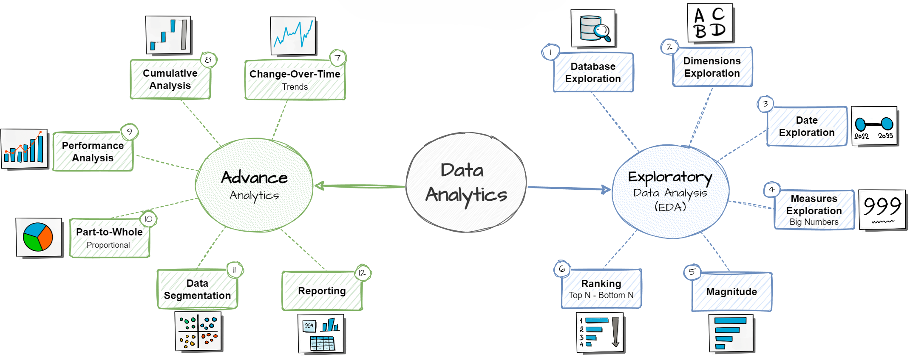

# Architecture Deep Dive

What each script does, the SQL techniques behind it, and how the 12 scripts build toward the two capstone reports.

## Where this fits

This project queries the Gold-layer star schema built in [sql-data-warehouse-project](https://github.com/VS-2K01/sql-data-warehouse-project) — three views (`gold.dim_customers`, `gold.dim_products`, `gold.fact_sales`) populated from CRM/ERP CSV exports via a full Bronze → Silver → Gold ETL pipeline. Nothing in this repo does any data loading or cleaning; it's SQL analysis on top of an already-clean warehouse.

## Roadmap

The 12 scripts follow a progression from basic exploration to business-ready reports:

### Exploratory Data Analysis

| # | Script | What it answers |
|---|---|---|
| 1 | `db_exploration.sql` | What tables/views/columns exist in this database? |
| 2 | `dim_exploration.sql` | What are the distinct values in each dimension (countries, categories, etc.)? |
| 3 | `daterange_exploration.sql` | What date range does the data cover, and how old is the oldest/youngest customer? |
| 4 | `measures_exploration.sql` | What are the key totals — total sales, total orders, total customers, total products? |
| 5 | `magnitude_analysis.sql` | How do totals break down across a dimension — e.g. total customers by country, total revenue by category? |
| 6 | `ranking_analysis.sql` | Top-N / bottom-N — which products generate the most revenue, which the least, using both `TOP` and `RANK()`/`DENSE_RANK()` window functions |

### Advanced Analytics

| # | Script | What it answers |
|---|---|---|
| 7 | `cot_analysis.sql` | How do sales change over time (by year, by month) — trend and seasonality, using `DATETRUNC()`/`DATEPART()` |
| 8 | `cumulative_analysis.sql` | What's the running total of sales over time, and the moving average price? (`SUM() OVER (ORDER BY ...)`) |
| 9 | `performance_analysis.sql` | Year-over-year product performance vs. its own average and vs. the prior year, using `LAG()` and `AVG() OVER()` |
| 10 | `part_to_whole_analysis.sql` | Which product categories contribute the most to overall sales, as a percentage of the whole |
| 11 | `data_segmentation.sql` | Segmenting products into cost ranges and customers into behavioral groups via `CASE` logic |
| 12 | `customer_report.sql`, `product_report.sql` | The two capstone views — see below |

## The two capstone reports

**`gold.report_customers`** (`customer_report.sql`) — one row per customer, built from a base query joining `fact_sales` to `dim_customers`, then aggregated into:
- Segmentation: age group (`Under 20` ... `50 and above`) and a VIP/Regular/New customer segment, where VIP = at least 12 months as a customer *and* over $5,000 in total sales
- KPIs: total orders, total sales, total quantity, total distinct products purchased, customer lifespan in months, recency (months since last order), average order value, and average monthly spend

**`gold.report_products`** (`product_report.sql`) — the same pattern applied to products: aggregates `fact_sales` by product, with its own set of performance and segmentation metrics.

Both are built as SQL views, so they're queryable directly (`SELECT * FROM gold.report_customers;`) rather than one-off ad-hoc scripts — the end state of the "Reporting" step in the roadmap above.

## SQL techniques used across the project

- **Window functions**: `SUM() OVER()`, `AVG() OVER()`, `RANK()`, `DENSE_RANK()`, `ROW_NUMBER()`, `LAG()`
- **CTEs** (`WITH ... AS`) to structure multi-stage aggregations (base query → aggregates → final labeled output) instead of deeply nested subqueries
- **Date functions**: `DATETRUNC()`, `DATEPART()`, `DATEDIFF()`, `FORMAT()`
- **Conditional aggregation and labeling** via `CASE` for segmentation logic
- **`GROUP BY` / `ORDER BY`** combined with aggregates for magnitude and ranking analysis
